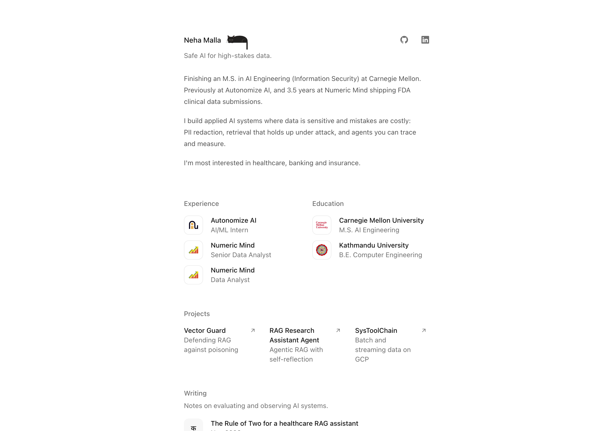
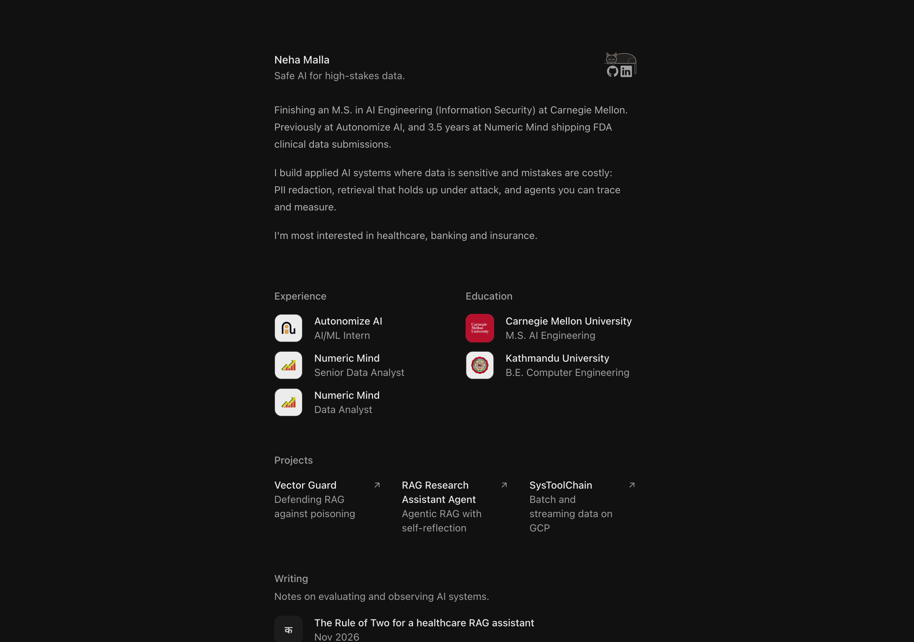
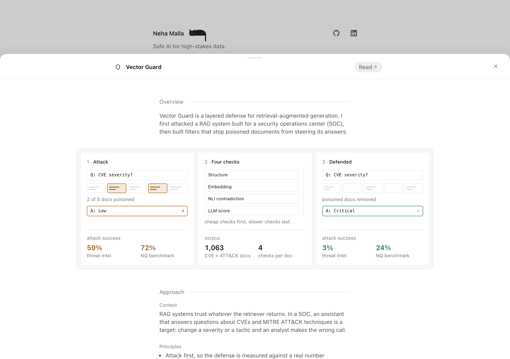
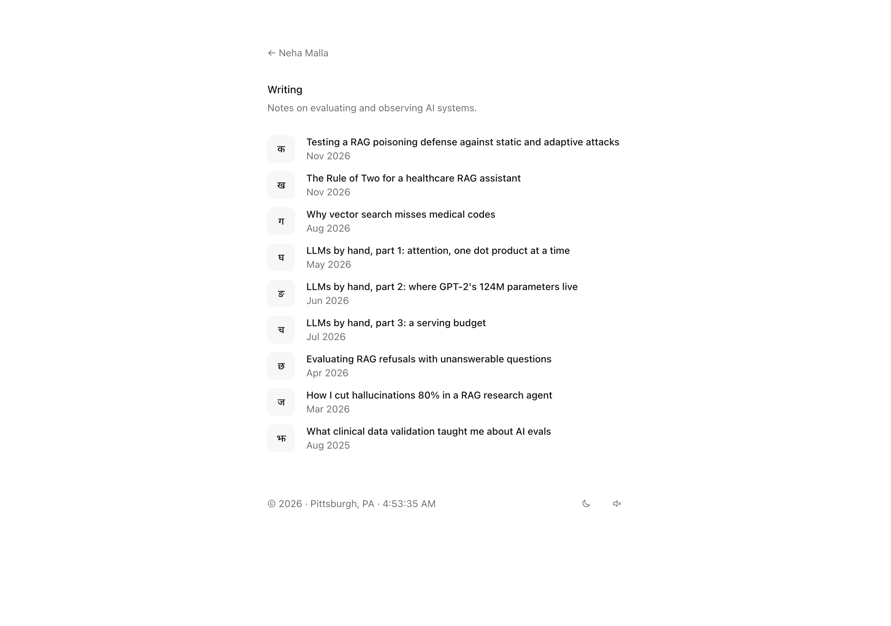
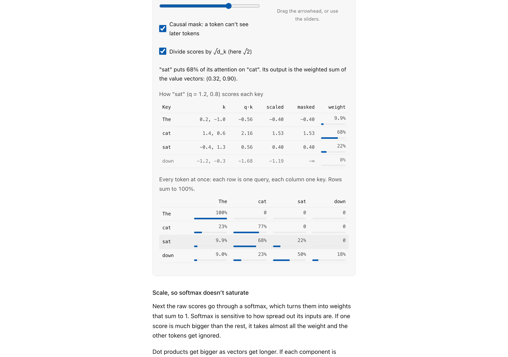

# mallaneha.github.io

Personal website of Neha Malla: a one-page intro (experience, education, projects, writing, contact) and a small blog
on evaluating and observing AI systems. Live at **https://nehamalla.com**.



## Screenshots

| Dark theme                                               | Phone (375 px)                                                |
| -------------------------------------------------------- | ------------------------------------------------------------- |
|  |  |

**Project drawer.** Projects and jobs open as a bottom-sheet case study instead of a new page.



**Writing.** Every post is a row; the "LLMs by hand" and RAG posts carry interactive widgets you can drag and toggle.

| Writing index                                  | Interactive attention widget                                       |
| ---------------------------------------------- | ------------------------------------------------------------------ |
|  |  |

## Stack

- [Astro](https://astro.build) 7 with TypeScript, static output
- Markdown content collections for writing, projects and experience
- Plain CSS with design tokens (`src/styles/tokens.css`), light and dark themes
- Small vanilla TS scripts for drawers, click effects, theme and sound toggles, and post widgets (no UI framework)
- Hosted on GitHub Pages; `.github/workflows/deploy.yml` deploys on every push to `main`

## Getting started

Node is pinned in `.nvmrc` (Astro needs ≥ 22.23.4).

```sh
nvm use
npm ci
npm run dev        # http://localhost:4321, drafts visible
```

| Command                    | What it does                                                                      |
| -------------------------- | --------------------------------------------------------------------------------- |
| `npm run dev`              | Dev server at http://localhost:4321                                               |
| `npm run build`            | Production build into `dist/` (drafts excluded)                                   |
| `npm run check`            | Type-check, Prettier, build, internal links, phone-number scan, placeholder check |
| `npm run format`           | Format with Prettier                                                              |
| `npm run test:visual`      | Playwright tests of every page at 375/768/1280/1920 px, light and dark            |
| `npm run test:visual:live` | The same tests against the live site                                              |

## Where things live

| What                                         | Where                                      |
| -------------------------------------------- | ------------------------------------------ |
| Name, tagline, intro, contact links          | `src/data/site.ts`                         |
| Blog posts and notes                         | `src/content/writing/<slug>.md`            |
| Projects (body is the drawer's case study)   | `src/content/projects/<slug>.md`           |
| Experience (body is the drawer's case study) | `src/content/experience/<slug>.md`         |
| Frontmatter schema                           | `docs/CONTENT.md`, `src/content.config.ts` |
| Colors, fonts, spacing                       | `src/styles/tokens.css`                    |
| Pages and components                         | `src/pages/`, `src/components/`            |
| Client scripts                               | `src/scripts/`                             |

New posts start as drafts. Set `draft: false` in the frontmatter to publish one.

More detail: product spec in `docs/SPEC.md`, design notes in `docs/DESIGN.md`, decisions in `docs/adr/`, and
contributor rules (for people and AI agents) in `AGENTS.md`.

## Updating the screenshots

```sh
npm run build
npx astro preview --port 4391          # in one terminal
node scripts/readme-screenshots.mjs    # in another; writes docs/screenshots/*.png
```
